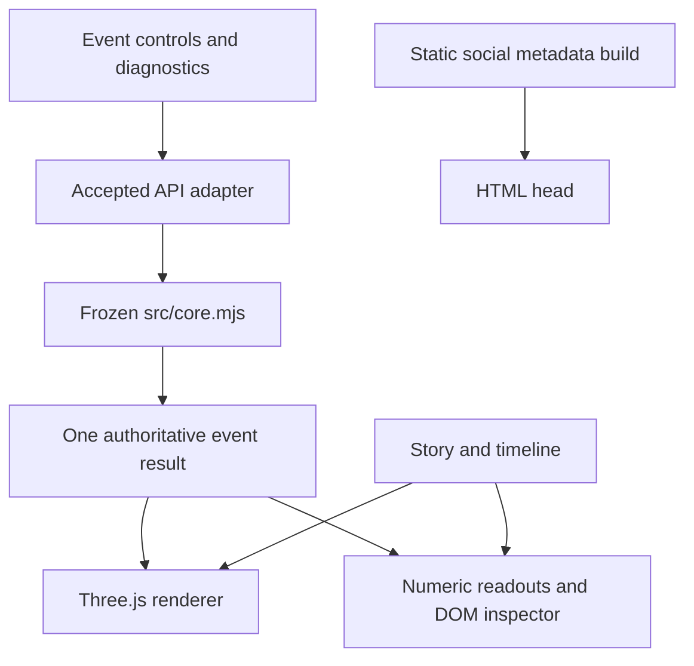

# Architecture

Native browser ES modules and Three.js 0.160.0, copied from the supplied vendor archive, keep the product static and the scientific file byte-identical. This choice avoids a compiler rewriting the core and keeps the deliverable runnable without downloading a framework. The adapter is JavaScript with JSDoc and TypeScript `.d.ts` contracts; this is not a compiled TypeScript or React application.

Generation, event type changes and exact fixture loading call the adapter once. Camera, timeline, layer, motion and Story Mode actions do not call physics. One canvas moves between the hero and observatory; it does not create two parallel scientific states. Per-frame uniforms reveal returned hit times. Truth segments use returned track endpoints. New light layers read returned tracks/points/hits and immutable display constants; their view transforms are classified in RENDERER_SEMANTICS.md. No photon trajectories or new reconstruction formulas are invented.

All detector coordinates come directly from the copied frozen geometry. Camera projection is the view transform. Sensor radius, light glyph size/brightness and source marker radius are presentation mappings, not physical sensor dimensions or calibrated light yield. The station, ice envelope, wireframe bounding regions and depth labels are schematic context. DeepCore DOMs are highlighted without moving them.

DOM spheres use one InstancedMesh. Hits use a single GPU point buffer. Strings use one line buffer. No shadow maps, bloom or post-processing passes. DPR starts capped at 1.75 desktop / 1.25 mobile and can fall to 0.8 when measured frame rate is low. Camera controls cancel cinematic interpolation. Reduced motion changes view transitions only. CSS display size and GPU framebuffer resolution are independent; their display rectangles are verified equal.

Diagnostics load lazily. Runtime JS/fonts are self-hosted. The only external website is an optional learning link. There is no backend or telemetry. Optional WebMCP exposes only a read-only current-event summary with an empty input schema.

The enriched renderer separates pure display mappings (visual-mapping.mjs) from bounded GPU/context layers (light-layers.mjs). Story uses the existing event clock; a candidate waits until the last modeled signal. Comparison harness hooks exist only in QA roots and never in dist.
